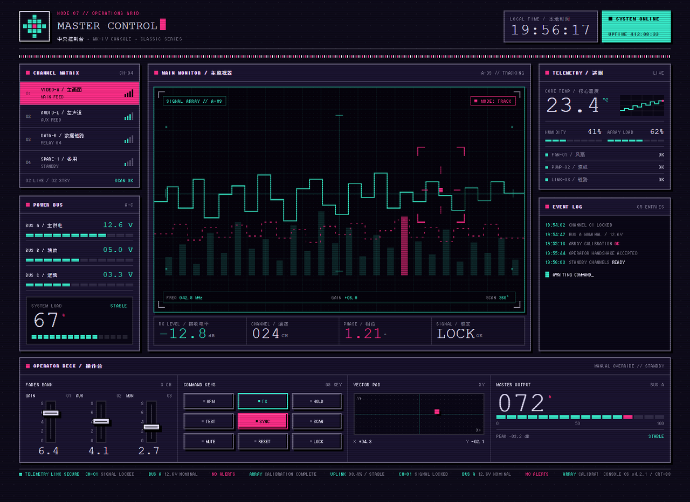
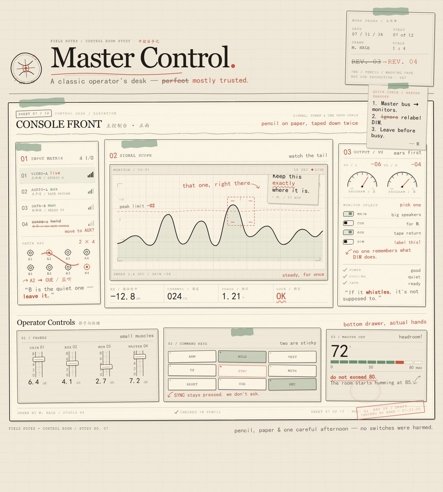
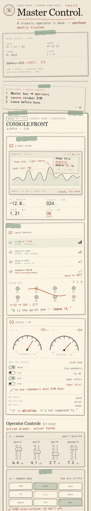
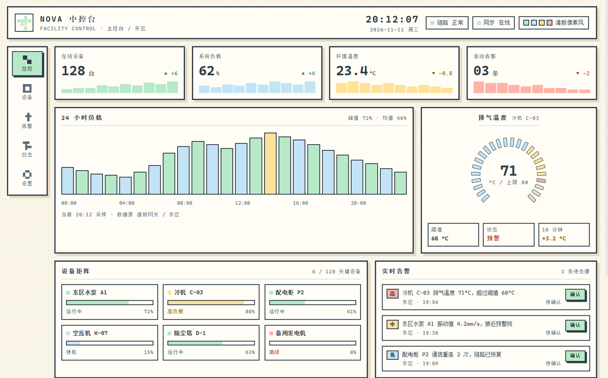

<p align="center"><a href="README.md">中文</a> · <a href="README.en.md">English</a></p>

# Visual Style Lock · DSH Plugin

A "style lock" for page generation in DeepSeek Harness. Pick a visual language once, and every page generated in every session is hard-constrained to it — then machine-checked before delivery.

It solves one recurring problem: models default to dark, flat, template-looking pages, and "make it look good" does not constrain anything.

---

## Preview

Same control console, same request, different lock:

<table>
<tr>
<td width="50%">

<br><sub><b>09 Retro Pixel / Y2K</b> — dark purple CRT, neon pink/cyan, zero radius, hard shadows</sub>
</td>
<td width="50%">

<br><sub><b>06 Creative Process</b> — paper base, pencil strokes, tape collage, stamps</sub>
</td>
</tr>
</table>

<p align="center">

<br><sub>The same style reflows on narrow screens (06 · mobile)</sub>
</p>

---

## How the lock works

Three layers, weakest to strongest:

| Layer | Mechanism | Effect |
|---|---|---|
| 1 | System prompt section | Injects the active style, the required workflow, and its hard rules into every step — new sessions included |
| 2 | `ui_style(contract)` | Returns the full spec: palette, shapes, typography, motion, forbidden list. No guessing colors |
| 3 | `ui_style(review)` | Turns the rules into executable checks and reports `rule + evidence + fix`, with `pass` and `score` |

This is not advice. Review actually fails pages: minimalism forbids hard shadows and gradients, glassmorphism requires `backdrop-filter`, bento requires `display:grid`, expressive type requires a ≥50px headline, scrollytelling requires sticky/scroll-driven scenes, dark-luxe forbids pure white, retro pixel forbids rounded corners and smooth gradients, neo-brutalism requires ≥3px outlines and hard shadows.

## The ten styles

| # | id | Name | Intent | Hard rules |
|---|---|---|---|---|
| 01 | `minimalism` | Minimalism | Whitespace, clear hierarchy, function first | 8px grid · two weights · 1px rules |
| 02 | `glassmorphism` | Glassmorphism | Frosted translucency, layered depth | `backdrop-filter` required · radius 12–16 · glass ≤40% area |
| 03 | `bento` | Bento Grid | Asymmetric cells sized by content priority | `display:grid` required · no equal grid · 16px gap |
| 04 | `typography` | Big & Expressive Type | Type as structure | Headline ≥56px · line-height ≤1.05 · one hero phrase |
| 05 | `scrollytelling` | Scroll-Driven Storytelling | Scroll drives scenes and pinned frames | sticky/scroll-driven · one scene per chapter · reduced-motion fallback |
| 06 | `craft` | Creative Process | Hand-drawn, collage, paper texture, unfinished | Paper base · at least one rotated element · offset hard shadow |
| 07 | `dark-luxe` | Dark / Luxe | Deep tonal steps, restrained gold | Three dark steps · gold <5% · no pure black/white |
| 08 | `motion` | Motion & Micro-interactions | 100–400ms feedback | 100–400ms transitions · hover/active/focus states · transform only |
| 09 | `retro-pixel` | Retro / Y2K / Pixel | 8-bit pixels, CRT glow, chrome bands | zero radius · hard shadows only · 8px pixel grid |
| 10 | `brutalism` | Neo-Brutalism | High contrast, hard borders, neon blocks | 3–4px black outlines · 6px hard shadows · neon blocks |

## Install

Requires DSH 0.2.x (`@deepseek-ai/dsh`). Plain JS, no dependencies, no build step.

1. Clone or download this repository, e.g. to `D:\plugins\dsh-ui-style-lock`.
2. Install that **directory** as a bundle with the DSH plugin manager (or let an agent run `plugin_manager install_bundle` with the directory as target).
3. Two sidebar entries appear: **Style Lock** (the gallery) and **Pixel Sample** (a built-in demo page).

Manual alternative — add to the profile's `cordis.patch.yml`:

```yaml
- insert:
    - id: ui-style-lock
      name: 'dsh-ui-style-lock'
```

Refresh the page once after installing so the client panels load.

## Usage

### Command

```
/style              list all styles and the current one
/style 03           switch by number
/style bento        switch by id
/style 玻璃拟态      switch by Chinese name
```

The choice is written to `.state.json` and applies across sessions and restarts. Delete that file to return to the default (01 Minimalism).

The receipt appears as a command row in the conversation. Note: a brand-new empty session shows the welcome hero, which covers the chat flow — send one message and the row is visible. That is DSH's rendering, not a failed switch.

### Conversation

Just say "switch to neo-brutalism" or "generate a page in 09". The agent calls `ui_style(use)` first, then generates against the new contract and self-checks before delivery.

### Tool

| Call | Returns |
|---|---|
| `ui_style({ action: "list" })` | All styles plus the current one |
| `ui_style({ action: "contract" })` | Full spec of the active style (optional `style`) |
| `ui_style({ action: "review", html })` | `pass` / `score` / violations (optional `style`) |
| `ui_style({ action: "use", style })` | Switch and persist |

## Review rules

`review` is regex-level, not a CSS parser. It catches structural mistakes, not "subtly ugly".

Shared checks:

- Root background brightness against the style's tone (light styles ≥0.45, dark ≤0.25)
- Radius ceiling, shadow type (hard / soft / none), blur and gradient allowance
- Minimum font size, palette hit count (fewer than 3 known colors reads as palette drift)

Per-style requirements and bans, for example:

| Style | Requires | Forbids |
|---|---|---|
| Glassmorphism | `backdrop-filter: blur()` | pure black |
| Bento | `display: grid` | — |
| Expressive type | at least one ≥50px font size | — |
| Scrollytelling | `position: sticky` / `scroll-timeline` / `IntersectionObserver` | wheel hijacking |
| Craft | rotation, paper texture or hand-drawn SVG | — |
| Retro pixel | monospace font | smooth gradients, any radius |
| Neo-brutalism | ≥3px solid outline | soft shadows |

## Built-in sample panel

The **Pixel Sample** panel is a control console rendered by the plugin itself — a reference for what the checks look like in practice:

<p align="center">

</p>

## Layout

```
index.js          host half: prompt section, ui_style tool, /style command, state
presets.js        the ten styles (palette, shapes, type, review rules)
engine.js         review engine: tone, radius, shadow, blur, gradient, size, palette, per-style rules
client.js         browser half: gallery panel + pixel demo page + sidebar icons
locale/*.json     plugin metadata (zh / en)
icon.svg          plugin icon
cordis.patch.yml  bundle patch
docs/             README screenshots
.state.json       runtime state (active style), git-ignored
```

## Adding an 11th style

1. Add an entry to `PRESETS` in `presets.js`: `id / zh / en / tagline / mood / swatches / radius / shadowDesc / borderDesc / type / layout / motion / locks / notes / forbidden / review`.
2. Mirror the display fields in `CATALOG` in `client.js` (number, name, swatches, three locks).
3. Reinstall the bundle or restart DSH.

In `review`, `bg / radiusMax / shadow / blur / gradient / minFont / palette` are shared switches; `require` and `forbid` are regex lists.

## FAQ

**I switched but saw no receipt.** In an empty session the command row sits behind the welcome hero; send a message and it shows. You can also ask the agent "what style is active?".

**Why can't I click a card in the gallery?** Static DSH plugins only get host → browser registration; there is no browser → host write channel (`host.call` exists for dynamic packages). So switching goes through the command or conversation, and the gallery is reference material.

**A review rule misfired.** The rules are regexes — relax the relevant `require` / `forbid` in `presets.js`, or drop the rule. They are scaffolding, not a standard.

**How do I reset?** Delete `.state.json` and reload the plugin.

## Limitations

- Aesthetics still need a human eye; `review` only catches structural problems.
- One style per page; no "base style + local exception" composition yet.
- State is global to the profile, not per session.

## License

MIT
