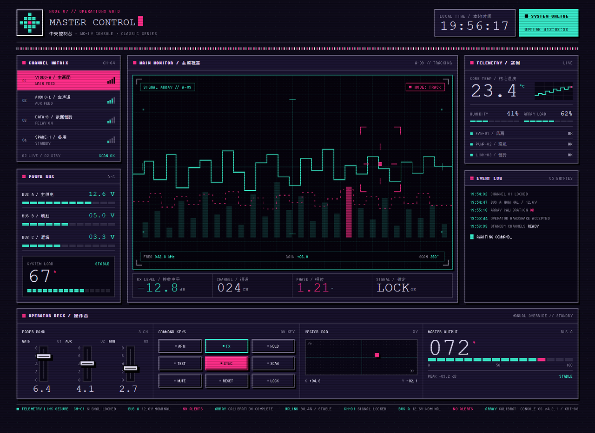
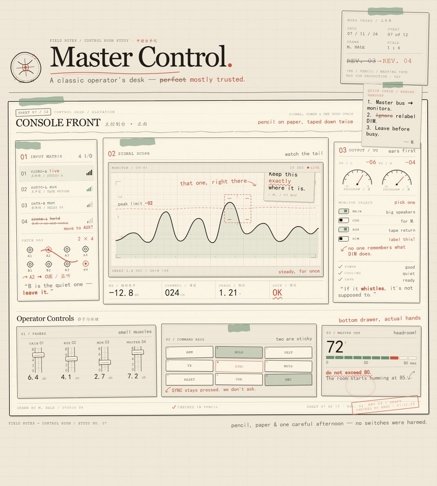
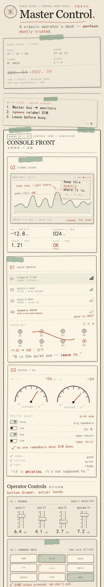
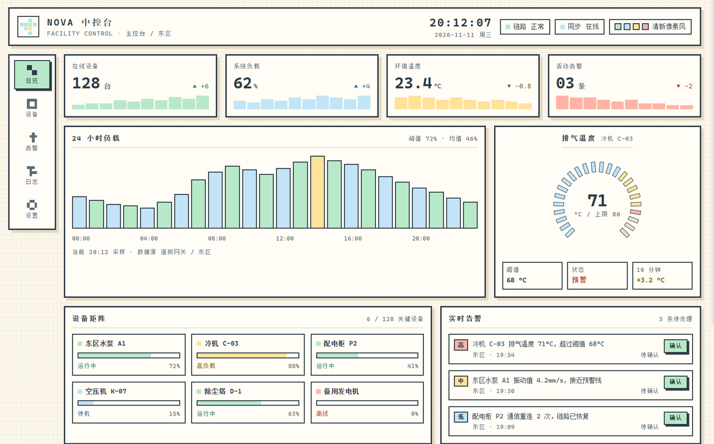

<p align="center"><a href="README.md">中文</a> · <a href="README.en.md">English</a></p>

# 视觉风格锁 · DSH 插件

给 DeepSeek Harness 的页面生成加一把「风格锁」：选一种视觉语言，之后所有会话生成的页面都被硬性约束在这套风格里，并在交付前被自动校验。

解决同一个老问题：模型默认倾向深色、单调、模板化的页面；口头说「做得好看点」约束不住。

---

## 效果

同一座「中控台」，同一句需求，切换风格锁之后的结果：

<table>
<tr>
<td width="50%">

<br><sub><b>09 复古像素 / Y2K</b> — 暗紫 CRT 底、荧光粉/青、圆角 0、硬阴影 0 模糊</sub>
</td>
<td width="50%">

<br><sub><b>06 手作过程感</b> — 纸感底色、铅笔线稿、胶带拼贴、印章批注</sub>
</td>
</tr>
</table>

<p align="center">

<br><sub>同一套风格在窄屏下自动重排（06 手作过程感 · 移动端）</sub>
</p>

---

## 它怎么「锁」

三层，越往下越硬：

| 层 | 机制 | 作用 |
|---|---|---|
| 1 | 系统提示段 | 每轮上下文固定注入「当前风格 + 必做流程 + 硬约束」，换会话、开新会话都躲不掉 |
| 2 | `ui_style(contract)` | 返回完整规范：色板、形状、版式、动效、禁例。禁止凭印象配色 |
| 3 | `ui_style(review)` | 把规则变成可执行检查，逐条报 `rule + 证据 + 改法`，输出 `pass` 与 `score` |

风格不是「建议」：review 会真的判违规。比如极简禁硬阴影与渐变、玻璃拟态必须有 `backdrop-filter`、Bento 必须用 `display:grid`、大字排版必须有 ≥50px 的标题、滚动叙事必须有 sticky/scroll 驱动、暗黑奢华禁纯白、复古像素禁圆角与平滑渐变、新粗野必须有 3px 以上描边和硬阴影。

## 10 种风格

| # | id | 名称 | 定位 | 硬约束 |
|---|---|---|---|---|
| 01 | `minimalism` | 极简主义 | 留白、清晰层级、功能优先 | 8px 网格 · 两级字重 · 1px 分隔线 |
| 02 | `glassmorphism` | 玻璃拟态 | 半透明磨砂、分层景深 | 必须 `backdrop-filter` · 圆角 12–16 · 玻璃 ≤40% 面积 |
| 03 | `bento` | Bento 网格 | 非对称卡片，尺寸由内容优先级决定 | 必须 `display:grid` · 禁止全等分 · gap 16px |
| 04 | `typography` | 大字排版 | 字体即结构，标题承担冲击力 | 标题 ≥56px · 行高 ≤1.05 · 一屏一个巨型短语 |
| 05 | `scrollytelling` | 滚动叙事 | 滚动位置驱动场景与固定画面 | sticky/scroll 驱动 · 每章一个场景 · reduced-motion 降级 |
| 06 | `craft` | 手作过程感 | 手绘、拼贴、纸纹、未完成感 | 纸感底色 · 至少一处旋转压边 · 错位硬阴影 |
| 07 | `dark-luxe` | 暗黑奢华 | 深色色阶 + 克制金调 | 三层深色色阶 · 金色用量 <5% · 禁纯黑白 |
| 08 | `motion` | 微交互动效 | 100–400ms 的反馈与过渡 | 过渡 100–400ms · hover/active/focus 三态齐 · 只动 transform |
| 09 | `retro-pixel` | 复古像素 / Y2K | 8-bit 像素、CRT 荧光、铬色硬分段 | 圆角 0 · 硬阴影 0 模糊 · 8px 像素网格 |
| 10 | `brutalism` | 新粗野主义 | 高对比、硬边框、荧光色块 | 3–4px 黑描边 · 6px 硬阴影 · 荧光色块拼接 |

## 安装

要求：DSH 0.2.x（`@deepseek-ai/dsh`）。纯 JS，无第三方依赖，无构建步骤。

1. 克隆或下载本仓库到本地，例如 `D:\plugins\dsh-ui-style-lock`。
2. 用 DSH 的插件管理器把这个**目录**作为 bundle 安装（或在会话里让 agent 执行 `plugin_manager install_bundle`，target 指向该目录）。
3. 安装后侧栏出现两个入口：**风格锁**（10 种风格图鉴）与 **像素示例**（内置示例页）。

手工方式：在 profile 的 `cordis.patch.yml` 里加

```yaml
- insert:
    - id: ui-style-lock
      name: 'dsh-ui-style-lock'
```

安装后建议刷新一次页面，客户端面板才会加载。

## 使用

### 1. 命令

```
/style              列出全部风格与当前项
/style 03           按编号切换
/style bento        按 id 切换
/style 玻璃拟态      按中文名切换
```

切换结果写入插件目录的 `.state.json`，**跨会话、跨重启生效**。删除该文件即回到默认风格（01 极简主义）。

回执会作为一行命令记录出现在对话流里。注意：全新空白会话会显示欢迎页，命令记录被挡在下面，发第一条消息后就能看到——这是 DSH 的渲染行为，不是没生效。

### 2. 对话

直接说「切换到新粗野主义」「用 09 生成一个页面」。agent 会先调 `ui_style(use)` 切换，再按新契约生成，并在交付前自检。

### 3. 工具

| 调用 | 返回 |
|---|---|
| `ui_style({ action: "list" })` | 全部风格 + 当前项 |
| `ui_style({ action: "contract" })` | 当前风格的完整规范（可带 `style` 指定） |
| `ui_style({ action: "review", html })` | `pass` / `score` / 违规清单（可带 `style` 指定按哪种风格校验） |
| `ui_style({ action: "use", style })` | 切换并持久化 |

## 校验规则

`review` 是正则级检查，不是 CSS 解析器。它拦的是「一眼假」的硬伤，不是「配色微妙地不好看」。

通用检查：

- 页面根节点底色与风格明暗基调是否匹配（浅色风格要求亮度 ≥0.45，深色 ≤0.25）
- 圆角上限、阴影类型（硬阴影 / 软阴影 / 禁用阴影）、模糊与渐变是否被允许
- 最小字号、规定色板的命中数（低于 3 个判为配色漂移）

每种风格另有专属的「必须出现」与「禁止出现」，例如：

| 风格 | 必须 | 禁止 |
|---|---|---|
| 玻璃拟态 | `backdrop-filter: blur()` | 纯黑 |
| Bento | `display: grid` | — |
| 大字排版 | 至少一处 ≥50px 字号 | — |
| 滚动叙事 | `position: sticky` / `scroll-timeline` / `IntersectionObserver` | 滚轮劫持 |
| 手作感 | 旋转、纸纹或手绘 SVG | — |
| 装饰像素 | 等宽字体 | 平滑渐变、任何圆角 |
| 新粗野 | 3px 以上实线描边 | 软阴影 |

## 内置示例页

侧栏的**像素示例**面板是插件自带的一张中控台页面，用来对照 review 规则实际长什么样：

<p align="center">

</p>

## 目录结构

```
index.js          宿主侧：系统提示段、ui_style 工具、/style 命令、状态读写
presets.js        10 种风格的数据（色板、形状、版式、review 规则）
engine.js         校验引擎：底色、圆角、阴影、模糊、渐变、字号、配色、专属规则
client.js         浏览器侧：风格图鉴面板 + 像素中控台示例页 + 侧栏图标
locale/*.json     插件元信息（中 / 英）
icon.svg          插件图标
cordis.patch.yml  bundle 加载补丁
docs/             README 用的示例截图
.state.json       运行时状态（当前风格），已在 .gitignore 中
```

## 加第 11 种风格

1. 在 `presets.js` 的 `PRESETS` 里加一条：`id / zh / en / tagline / mood / swatches / radius / shadowDesc / borderDesc / type / layout / motion / locks / notes / forbidden / review`。
2. 在 `client.js` 的 `CATALOG` 里补同名展示字段（编号、名称、色板、三条约束）。
3. 重装 bundle 或重启 DSH。

`review` 里 `bg / radiusMax / shadow / blur / gradient / minFont / palette` 是通用开关，`require` 与 `forbid` 是正则数组。

## 常见问题

**切换了但没看到提示？** 在空白会话里，命令回执会被欢迎页遮住；发一条消息后即可在对话流看到那一行。也可以直接问 agent「现在是什么风格」。

**图鉴页为什么不能点选？** DSH 的静态插件只有「宿主 → 浏览器」的单向注册，没有浏览器 → 宿主的写通道（`host.call` 仅对动态包开放）。所以切换走 `/style` 命令或对话，图鉴只做参考与复制指令。

**review 误判了怎么办？** 规则就是正则，遇到合法写法可以放宽 `presets.js` 里对应风格的 `require` / `forbid`，或直接把这条规则删掉——它只是脚手架，不是标准。

**怎么恢复默认？** 删掉 `.state.json`，重新加载插件。

## 已知限制

- 观感仍需要人眼验收；`review` 只会拦结构性硬伤。
- 一个页面一种风格；暂不支持「主风格 + 局部例外」的组合配置。
- 状态是全局的（整个 profile 一份），不按会话隔离。

## License

MIT
